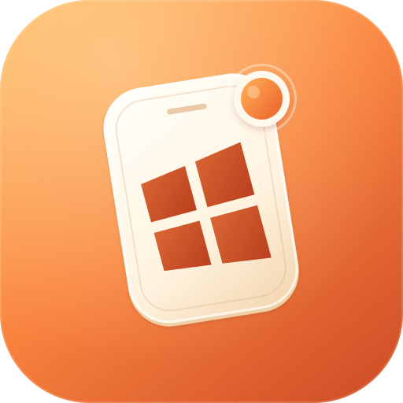
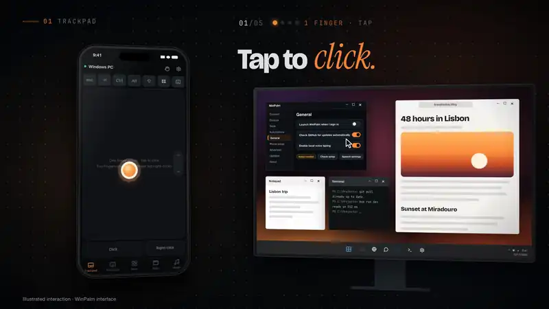
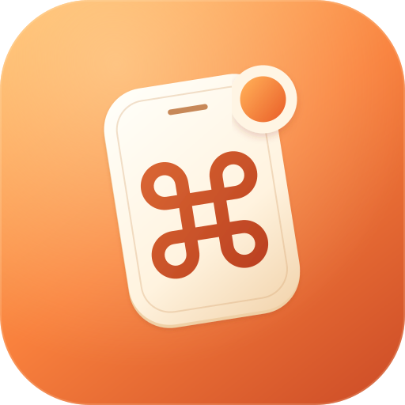
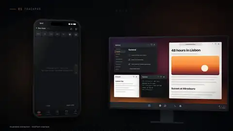
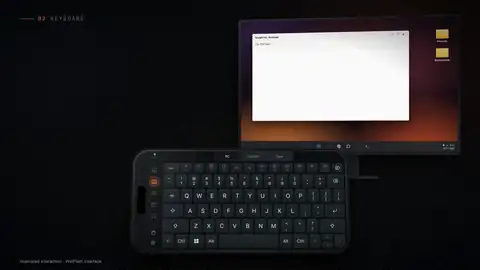
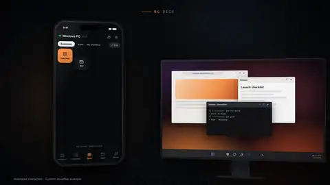
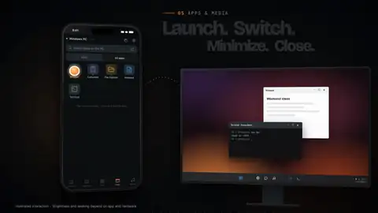
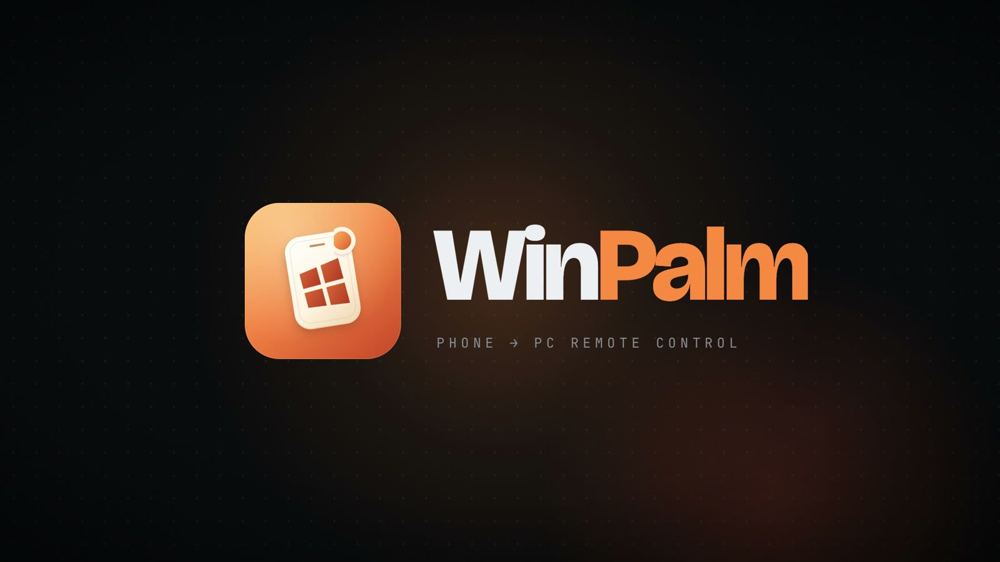

<div align="center">



# WinPalm

### Your PC, in your palm.

Turn your iPhone, iPad or Android phone into a wireless mouse, trackpad,<br />
keyboard and shortcut deck for Windows.<br />
**No phone app. No account. Your controls stay on your network.**

<br />

<a href="https://github.com/rahatsagor/WinPalm/releases/latest/download/WinPalm-Setup.exe"></a>
&nbsp;
<a href="https://winpalm.rsapplication.com"></a>
&nbsp;
<a href="https://winpalm.rsapplication.com/docs/"></a>

<br />

[](https://github.com/rahatsagor/WinPalm/releases/latest)
[](https://github.com/rahatsagor/WinPalm/actions/workflows/ci.yml)
[](#requirements)
[](LICENSE)

[Guides](https://winpalm.rsapplication.com/guides/) · [Using a Mac? Meet CmdPalm](#using-a-mac-meet-cmdpalm)

<br />

<a href="https://winpalm.rsapplication.com"></a>

<sub><a href="https://winpalm.rsapplication.com/#film">▶ Watch the 86-second launch film</a> · <a href="https://winpalm.rsapplication.com">Try the interactive demo</a></sub>

</div>

## Using a Mac? Meet CmdPalm.

<table>
<tr>
<td width="180" align="center" valign="middle">
<a href="https://github.com/rahatsagor/CmdPalm"></a>
</td>
<td valign="middle">

<sub>ALSO FROM RS APPLICATION</sub>

### Your Mac, in your palm.

**[CmdPalm](https://github.com/rahatsagor/CmdPalm)** brings the same phone-to-computer idea to macOS, with native Mac input and integrations. Turn your phone into a Mac trackpad, keyboard and shortcut deck.

**[CmdPalm on GitHub →](https://github.com/rahatsagor/CmdPalm)** · [Website](https://cmdpalm.app) · [Mac documentation](https://cmdpalm.app/docs/)

</td>
</tr>
</table>

## Install and connect

1. **[Download WinPalm-Setup.exe](https://github.com/rahatsagor/WinPalm/releases/latest/download/WinPalm-Setup.exe)** and run it. One installer chooses the native x64 or ARM64 app and includes its .NET runtime. No administrator access or separate runtime installation is needed.
2. **Open WinPalm** from Start. Allow Windows Firewall on your **Private** home network, and keep your phone and PC on that network.
3. **Scan the QR code** with your phone camera. You can also open the displayed address and enter its PIN, or request approval on the PC.
4. **Add to your phone's home screen** for an app-like experience.

Setup adds a Start menu shortcut. Desktop and sign-in shortcuts are optional. Closing the window keeps WinPalm in the notification area; reopen, pause or quit it from the tray. **Ctrl + Alt + Pause** toggles control when that shortcut is available.

### Windows download and installation warnings

WinPalm is currently **unsigned**, so Windows cannot verify a trusted publisher signature. New or uncommon unsigned apps can trigger a warning in your browser while downloading and a separate Windows SmartScreen warning when opened. You may therefore see more than one confirmation.

Continue only if you downloaded **WinPalm-Setup.exe** from the [official GitHub Releases](https://github.com/rahatsagor/WinPalm/releases/latest) and trust the project:

1. **Browser download:** if Microsoft Edge says the file **isn't commonly downloaded**, choose **Keep**. If another confirmation appears, choose **Show more → Keep anyway**.
2. **Windows launch:** open the downloaded installer. If SmartScreen shows **Windows protected your PC**, choose **More info → Run anyway**, if available.
3. Finish the normal per-user installation and open WinPalm from Start.

These steps apply to unrecognized-app and reputation warnings. If a warning names a malware threat, stop and [report the exact detection](https://github.com/rahatsagor/WinPalm/issues). **Smart App Control or an organization policy can block unsigned apps without an individual override.** If **Run anyway** is unavailable, contact your administrator on a managed PC or wait for a signed release. We do not recommend disabling antivirus or Smart App Control. See [Microsoft's Smart App Control FAQ](https://support.microsoft.com/en-us/windows/security/threat-malware-protection/smart-app-control-frequently-asked-questions) and the [installation guide](https://winpalm.rsapplication.com/docs/getting-started/#windows-download-and-installation-warnings).

**Future signing:** we plan to purchase and renew a trusted Windows code-signing certificate if WinPalm gains enough adoption or sponsorship to cover the recurring cost. This will let Windows verify the publisher of future releases. Newly signed apps can still show SmartScreen warnings while reputation builds. [Microsoft explains signing and reputation](https://learn.microsoft.com/en-us/windows/apps/package-and-deploy/smartscreen-reputation).

<details>
<summary><strong>Prefer a portable copy?</strong></summary>

Download the matching `win-x64.zip` or `win-arm64.zip` from [Releases](https://github.com/rahatsagor/WinPalm/releases/latest), extract the **whole ZIP** to a permanent folder and open `WinPalm.exe`. Keep `winpalm_core.dll`, `web/` and `Resources/` alongside it. Your architecture is listed in **Settings → System → About → System type**.

If you used a private development preview, quit it and install 0.1.0 manually once. Preview version numbers do not follow the public release sequence. Existing private device data stays in the same per-user folder.

</details>

## Everything you need from the couch

<table>
<tr>
<td width="50%" valign="top">



#### Trackpad
Tap to click, right-click, drag, drag lock and three-finger drag. Scroll with two fingers, momentum or a one-thumb strip. Pinch to zoom and assign your own finger gestures.

</td>
<td width="50%" valign="top">



#### Keyboard
Your PC's active layout, left and right modifiers, function and media keys, Unicode typing and clipboard paste with restoration. A sideways keyboard fills an upright phone. Tap Win to open Start, or hold Ctrl while another finger presses a letter.

</td>
</tr>
<tr>
<td valign="top">


#### Custom keyboards
Build the controls you need for games, presentations and editing. Hold several keys at once; each stays pressed while you touch it. Edit the layout and drag tabs to reorder your keyboards.

</td>
<td valign="top">



#### Shortcut Deck
A button grid for shortcuts, snippets, apps, websites, clicks and multi-step actions. Resize buttons, reorder pages, and import or export from the PC. PowerShell actions are available when you enable them.

</td>
</tr>
<tr>
<td valign="top">



#### Apps and media
Find Start Menu, Store and portable apps. Launch, switch, minimize and request a graceful close. Control playback, volume, mute and supported display brightness.

</td>
<td valign="top">


#### Local voice typing
Speak into your phone and let a compatible installed Windows recognizer type on the PC. Audio stays on your network. Requires trusted HTTPS and a supported offline speech language; check setup in General.

</td>
</tr>
</table>

<sub>Animated previews from the launch film: WinPalm phone UI with illustrated PC responses, without live Windows footage.</sub>

Pair multiple phones and tablets. Settings, custom keyboards and gestures are backed up on the PC for each device. **Copy settings from another device** lets you select individual settings sections and keyboards. Deck pages are shared across paired devices.

For slides, use large arrow keys. For games, make a WASD layout. For movie night, keep playback and volume within reach. For editing and streaming, put your repeated shortcuts on a Deck page. Explore the [guides](https://winpalm.rsapplication.com/guides/) for more ideas.

<div align="center">

<a href="https://winpalm.rsapplication.com/#film"></a>

<sub><a href="https://winpalm.rsapplication.com/#film">▶ Watch the 86-second film on winpalm.rsapplication.com</a></sub>

</div>

## Private by design

- **No accounts or analytics.** Phone controls connect directly to your PC over your local network.
- **Pair devices you trust.** Use QR, PIN or explicit PC approval; revoke a device from Windows at any time.
- **You stay in control.** Pause releases held input and stops running commands and dictation. PowerShell is off by default and uses your normal user permissions when enabled.
- **Your setup stays on your PC.** Pairings, settings, Deck pages, custom keyboards and certificates live under `%LOCALAPPDATA%\RS Application\WinPalm`.

Use trusted HTTPS where network traffic could be observed. HTTP does not encrypt input or reconnect tokens. Update checks contact GitHub and can be turned off. Using your phone keyboard's own dictation follows the phone provider's privacy settings. See [SECURITY.md](SECURITY.md) for the full model.

## Requirements

- **Windows 11 recommended**, on Intel/AMD x64 or ARM64. Setup accepts Windows 10 version 1809 or later; every older Windows/driver combination has not been verified. There is no 32-bit app.
- **iOS/iPadOS 17+**, or a current Android browser.
- **A shared private network**, with Windows Firewall allowing WinPalm. No public internet port is needed.
- **For voice typing:** trusted HTTPS and a compatible installed offline Windows speech recognizer.

WinPalm runs with normal user permissions. UAC prompts, the lock screen and higher-integrity apps are protected by Windows. Some games and remote desktop apps reject synthetic input; media seeking, brightness and app activation depend on Windows, the app and hardware support.

## Updates

WinPalm checks GitHub once a day for a newer stable release and shows a notification. Turn automatic checks off in General or Updates, or choose **Check for updates** from the tray.

Choose **Download and restart** to verify the native package, replace the app and reopen it. Installed and portable copies use the same updater. Pairings, settings, Deck pages, custom keyboards and certificates are retained. Replacement failures, or a new process exiting before startup confirmation, restore the previous package.

You can also download and run the latest **[WinPalm-Setup.exe](https://github.com/rahatsagor/WinPalm/releases/latest/download/WinPalm-Setup.exe)** over your installation. Use this route for read-only, network or linked app folders, or when an in-app update is unavailable. Drafts and prereleases are excluded from automatic checks.

## Docs and troubleshooting

Start with the **[documentation](https://winpalm.rsapplication.com/docs/)** for installation, pairing, HTTPS, voice typing and settings. The **[guides](https://winpalm.rsapplication.com/guides/)** cover everyday workflows.

- **Phone cannot connect:** check the shared network, Windows Private profile and Windows Firewall. The PC's Connect page links to network/firewall settings when it detects a problem. Do not expose WinPalm's port to the public internet.
- **Microphone unavailable:** export the public certificate from Phone setup, verify its fingerprint, trust it on your phone, and connect using HTTPS. On iPhone, also enable full trust in **Settings → General → About → Certificate Trust Settings**. Never transfer the private key.
- **Speech will not start:** choose **General → Check speech setup** on Windows. Install or repair a compatible offline speech language, then restart WinPalm. Recognition support and quality depend on the installed recognizer.
- **Need a diagnostic report:** run **Test-WinPalm.cmd** from the app folder. Its disposable checks cover the native DLL, storage, icons, server, pairing and pause/revocation. The optional input test uses a temporary editor; leave the PC idle while it runs.

Reports are saved to `%TEMP%\WinPalm-selftest.json` and `%TEMP%\WinPalm-input-test.json`. When [reporting a bug](https://github.com/rahatsagor/WinPalm/issues), include your Windows version, architecture, keyboard layout and phone/browser. Hardware and speech behavior require checks on the actual PC.

## Build and contribute

Install Git, **Bun**, stable Rust with the MSVC toolchain, the .NET SDK selected in [global.json](global.json), and Visual Studio Build Tools with Desktop development with C++. ARM64 builds need the corresponding C++ tools and Windows SDK. In PowerShell 7:

```powershell
./scripts/build.ps1 -Architecture x64 -Package
./scripts/build.ps1 -Architecture arm64 -Package
# With NSIS 3.10+ installed, combine both native payloads into one setup:
bun scripts/build-installer.ts --payloads ../winpalm-dev/artifacts/builds --output ../winpalm-dev/artifacts/WinPalm-0.1.0-Setup.exe
```

Builds, dependencies, caches and local reports go to `../winpalm-dev/`. The source repository contains the app, tests, packaging and public project documentation. Release assets are distributed through GitHub Releases. Each app package includes its corresponding source and licenses.

Future releases follow CmdPalm's routine: update the changelog, run **`bun scripts/bump-version.ts VERSION`**, commit and push, then tag **`vVERSION`**. The release workflow runs native x64/ARM64 checks, builds setup, verifies checksums and publishes the release. See [CONTRIBUTING.md](CONTRIBUTING.md), [the release guide](docs/RELEASING.md) and [the protocol](docs/PROTOCOL.md).

## License

Built by **[RS Application](https://rsapplication.com)**. WinPalm adapts CmdPalm 0.7.0's Rust engine and Vue phone client for Windows. See [NOTICE](NOTICE) for provenance and [THIRD_PARTY_NOTICES.md](THIRD_PARTY_NOTICES.md) for dependency licenses.

Licensed under **[AGPL-3.0-only](LICENSE)**.

<div align="center">
<br />
<a href="https://winpalm.rsapplication.com"></a>
<br />
<a href="https://winpalm.rsapplication.com"><strong>winpalm.rsapplication.com</strong></a>
</div>
